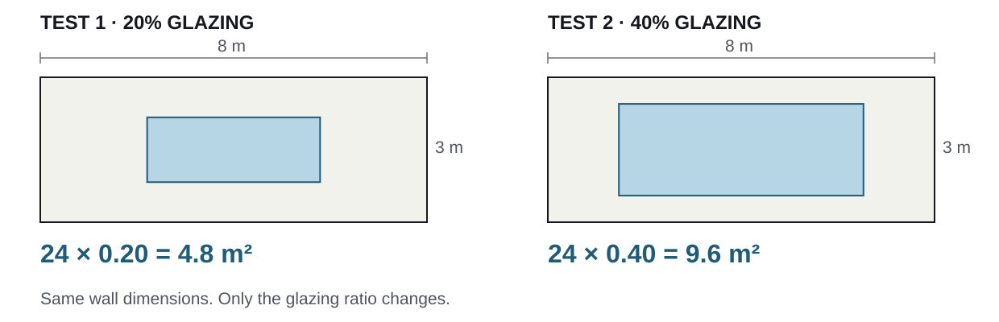

## Last week gave you two starting points {#last-week}

[Session 1 · reconnect · 5 minutes]{.task-meta}

:::: {.two-col}
::: {.concept-card}
[Your submitted A2]{.label .concept}

[The workflow proposal]{.card-title}

One design decision, evidence sources, a chosen route, and an intended output.
:::
::: {.activity-card}
[Your personal website]{.label .activity}

[A place to show the work]{.card-title}

We used half of last week's lab to set up a personal site with GitHub Pages.
:::
::::

::: {.takeaway}
Today, connect the two: explain the proposal, test one step, and record what happened.
:::

::: {.notes}
Opening block: 5 minutes for this slide and the next two. Acknowledge the actual Week 6 website activity. Students with unfinished publishing setup can use a local page throughout today's clinic.
:::

## Use the first attempt in a lab revision cycle {#today-sequence}

Session 1: attempt a small test. Session 2: use that attempt in this cycle.

:::: {.process-chain}
::: {.process-step}
[01 · Explain]{.label .concept}

**Open your A2**

Show the decision and the route you selected.
:::
::: {.process-step}
[02 · Discuss]{.label .reflect}

**Choose a response**

Use peer feedback to choose what to test next.
:::
::: {.process-step}
[03 · Test]{.label .activity}

**Run one step**

Save an output or record exactly where it stops.
:::
::: {.process-step}
[04 · Document]{.label .example}

**Update your page**

Show the test, its status, and the next action.
:::
::::

::: {.task-output}
**Today's record:** one attempted test + one dated feedback/action entry + an updated project page or local draft.
:::

## Two sessions, two jobs {#session-map}

:::: {.two-col}
::: {.concept-card}
[Session 1 · 50 minutes]{.label .concept}

[Understand and prepare]{.card-title}

| Minutes | Work |
|---|---|
| 0–5 | Reconnect A2 and the website |
| 5–15 | Define a small, checkable prototype |
| 15–25 | Follow one worked example |
| 25–45 | Attempt a test on your own project |
| 45–50 | Prepare your A2 walkthrough |
:::
::: {.activity-card}
[Session 2 · 50 minutes]{.label .activity}

[Discuss and revise]{.card-title}

| Minutes | Work |
|---|---|
| 0–20 | A2 walkthroughs in groups of three |
| 20–25 | Instructor debrief |
| 25–45 | Apply feedback and update your page |
| 45–50 | Peer page check and Slack exit |
:::
::::

A 10-minute break separates the sessions. All lab times restart at **0** after the break.

## Understand the first test {.section-slide background-color="#1F5C7A" #understand}

[01]{.section-number}

[Session 1 · concepts and worked example]{.label .concept}

[Choose one operation whose input, change, output, and check you can name.]{.section-lead}

## A prototype makes one workflow step inspectable {#prototype-definition}

A **workflow** is the sequence that turns inputs into an output. A **prototype** is a small working version you can run and inspect.

:::: {.tool-panel}
::: {.zone .input}
**Input**
The file, geometry, data, or values you start with.
:::
::: {.zone .operation}
**Change**
The one variable you alter. State what stays fixed.
:::
::: {.zone .output}
**Output**
The value, table, figure, or geometry you save.
:::
::: {.zone .check}
**Check**
A specific comparison that can reveal an error.
:::
::::

::: {.takeaway}
Make these four labels explicit in your test, walkthrough, and project page.
:::

::: {.notes}
Concept block: 10 minutes including section divider and the next three slides. "Change" is today's short label for the assignment's variable/range or "what varies". Keep exactly these four labels throughout the live deck.
:::

## Separate the check from the design decision {#check-versus-decision}

:::: {.two-col}
::: {.concept-card}
[Check the workflow]{.label .concept}

[Did this step work as intended?]{.card-title}

For a 24 m² wall, 20% glazing should give **4.8 m²** of window area.

Compare the exported area with that hand calculation.
:::
::: {.reflection-card}
[Interpret the design]{.label .reflect}

[Does this result support an action?]{.card-title}

Which glazing ratio should we select for the facade?

That needs relevant performance evidence and a stated comparison rule.
:::
::::

::: {.takeaway}
A correct area calculation alone does not establish daylight or cooling performance.
:::

## Name the state of your test {#test-status}

| Label on your page | What it means | What to record |
|---|---|---|
| [Planned]{.status-tag .status-planned} | You have not run this test. | Intended input, change, output, and check. |
| [Attempted · blocked]{.status-tag .status-blocked} | You tried; a specific step stopped the run. | Failed step, error or symptom, and next repair. |
| [Output saved]{.status-tag .status-tested} | The run produced an output you can show. | Output file and check result: **passed, failed, or pending**. |

::: {.task-output}
**Week 7 completion:** attempt a test. A documented blocker is a valid clinic outcome. A plan alone still needs an attempt.
:::

::: {.notes}
The green status means output exists, not that the entire method is verified. A failed or pending check remains visible. Do not describe a planned simulation as a completed result.
:::

## Your software route determines the first operation {#route-choices}

| Route | One small operation | One check to record |
|---|---|---|
| Spreadsheet | Change one parameter; recalculate a row. | Recalculate that row by hand. |
| GIS | Run one buffer or overlay. | Inspect CRS, units, and one known location. |
| Python / notebook | Run one function on a small input. | Compare with a known expected value. |
| Grasshopper | Change one slider; export geometry or area. | Check units and one dimension or area. |
| BIM/BEM / simulation | Run one simplified case. | Inspect input settings and run warnings. |
| AI-assisted component | Run and inspect the generated step. | Check its result independently of the AI answer. |

Use the route selected in **your A2**. [Starter kits](../starter_kits/README.md) are available if you need a runnable starting point.

## Worked example: a facade proposal becomes a test {#worked-example}

[Teaching example · calculated geometry · no performance results]{.task-meta}

:::: {.process-chain}
::: {.process-step}
[A2 proposal]{.label .concept}

**Compare glazing ratios**

Explore 20%, 40%, and 60% glazing for the same facade.
:::
::: {.process-step}
[Clinic feedback]{.label .reflect}

**Check the geometry first**

Can the workflow generate and export the area you intended?
:::
::: {.process-step}
[Week 7 test]{.label .activity}

**Calculate two cases**

Fix the wall at 8 m × 3 m. Change only the glazing ratio.
:::
::::

::: {.takeaway}
The first test checks the geometry step before adding performance analysis.
:::

::: {.notes}
Worked-example block: 10 minutes for this and the next three slides. This is an illustrative classroom example, not student work or measured facade performance. A3 still needs at least three variants by Week 9.
:::

## Change one input; predict the output {#area-example}

{width="100%" fig-alt="Two 8 by 3 metre walls. At 20 percent glazing the window area is 4.8 square metres; at 40 percent it is 9.6 square metres."}

::: {.tool-panel}
::: {.zone .input}
**Input**
Wall width 8 m; height 3 m.
:::
::: {.zone .operation}
**Change**
Glazing ratio: 0.20 → 0.40.
:::
::: {.zone .output}
**Output**
Window area in m² for each case.
:::
::: {.zone .check}
**Check**
Compare exported area with 24 × ratio.
:::
:::

::: {.notes}
Demonstrate with a spreadsheet formula or a GH area output. The drawing shows geometric proportions only. If demonstrating GH, confirm the model units before comparing areas.
:::

## Save both the result and the check {#example-result}

[Illustrative record · arithmetic shown for teaching]{.task-meta}

| Glazing ratio | Calculated window area | Independent check | Status |
|---|---:|---|---|
| 20% | 4.8 m² | 8 × 3 × 0.20 = 4.8 m² | Output saved; check passed |
| 40% | 9.6 m² | 8 × 3 × 0.40 = 9.6 m² | Output saved; check passed |
| 60% | — | Check when this case is run. | Planned |

::: {.reflection-card}
**What this supports:** the two area calculations match the intended ratios.

**What remains open:** daylight, cooling, and the choice of a facade option.
:::

Next action: add the third case, then connect the geometry to a justified performance method for A3.

## The page shows the same test in context {#example-page}

:::: {.example-sheet}
[ARCH7476 project section · illustrative entry]{.label .example}

::: {.page-line}
::: {}
**Decision**
:::
::: {}
Which glazing ratio should I carry forward for this facade?
:::
:::
::: {.page-line}
::: {}
**Workflow**
:::
::: {}
Input: 8 × 3 m wall. Change: glazing ratio. Output: window area. Check: 24 × ratio.
:::
:::
::: {.page-line}
::: {}
**Test record**
:::
::: {}
20% → 4.8 m²; 40% → 9.6 m². Area checks passed. Performance analysis is still planned.
:::
:::
::: {.page-line}
::: {}
**Feedback → action**
:::
::: {}
Week 7 · [enter date]. “Check geometry first.” I added an area check. Next: test 60%.
:::
:::
::::

Link the result to its source file and run instructions. Keep the test date and limits visible.

## Attempt one step on your own project {#first-attempt}

[Session 1 · minutes 25–45 · individual work · 20 minutes]{.task-meta}

Open your **A2 PDF** and the **file or tool for your selected workflow**.

::: {.task-steps}
1. **First 5 minutes:** name Input, Change, Output, and Check for one small test.
2. **Next 10 minutes:** attempt the operation. Save the output, or capture the failed step and error/symptom.
3. **Last 5 minutes:** record the test status, check result, and one question for your peers.
:::

::: {.task-output}
**Done when:** you can show a test record with an output or a specific blocker. Keep it open beside your A2.
:::

::: {.notes}
Hold this slide for the work period. The next slide supplies the fallback. Help students choose a smaller operation rather than attempting an entire model or application. Preparing a plan uses the first five minutes; the remaining time must include an attempt.
:::

## If the tool stops you, record the exact stopping point {#blocked-route}

| Situation | Do this now | Keep this evidence |
|---|---|---|
| The file opens but the run fails. | Repeat the smallest failing step once; record what happens. | Input, command/component, and error or symptom. |
| A required tool or input is missing. | Name it; attempt one hand-checkable row or calculation using available input. | Small calculation, its assumptions, and the missing dependency. |
| GitHub Pages is not live. | Edit the same project content in local `index.html` or a document. | Local page/document and a screenshot for Slack. |

::: {.task-output}
**Write a repair action:** “Next I will ___; I will know it worked when ___.”
:::

A hand calculation checks a limited step. Label which part of the intended workflow remains untested.

## Prepare a three-minute explanation of A2 {#prepare-walkthrough}

[Session 1 · minutes 45–50 · individual preparation · 5 minutes]{.task-meta}

Mark the relevant page or diagram in your submitted PDF. Keep your test record beside it.

| Speaking time | Show and explain |
|---|---|
| 0:00–1:00 | The design decision, chosen evidence, and one evidence limit. |
| 1:00–2:00 | Why this workflow fits. Identify Input, Change, Output, and Check. |
| 2:00–3:00 | Today's output or blocker. End with one specific question. |

::: {.task-output}
**Ready when:** the PDF and test record are open, and your question names a decision, assumption, or failed step.
:::

**First 2 minutes:** review the speaking and feedback protocol together. **Next 3 minutes:** prepare your own explanation. Listeners will clarify a problem, propose a test, then let you record a response.

Use your existing A2 pages. No new presentation deck is needed.

## Break {.section-slide background-color="#16181D" #break}

[10 minutes]{.section-number}

[After the break: Session 2 starts at lab minute 0.]{.section-lead}

Keep these open: **A2 PDF · test record · personal site or local draft.**

## Explain A2 and receive feedback {.section-slide background-color="#2F6F5E" #clinic}

[02]{.section-number}

[Session 2 · first 20 minutes]{.label .activity}

[Every student gets a turn to explain the submitted proposal and discuss the next test.]{.section-lead}

## Three people; three six-minute turns {#clinic-timing}

[Lab minutes 0–20 · groups of three]{.task-meta}

| Lab time | Who explains? | What happens? |
|---|---|---|
| 0–2 min | Everyone | Form groups and choose order: A, B, C. |
| 2–8 min | Student A | 3 minutes explaining + 3 minutes of peer feedback. |
| 8–14 min | Student B | 3 minutes explaining + 3 minutes of peer feedback. |
| 14–20 min | Student C | 3 minutes explaining + 3 minutes of peer feedback. |

The two listeners **share** the three-minute feedback period. One keeps time; the speaker records the advice.

::: {.task-output}
**If you are a pair:** use two six-minute turns, then use the remaining six minutes to sharpen both next-test plans. Do not form a group of four.
:::

::: {.notes}
Instructor: form triads, with pairs for any remainder (e.g. 3+2+2 rather than 3+3+1). Circulate during the clinic and revision sprint. Peer feedback is built into every turn; do not promise a separate instructor consultation to each student within 20 minutes.
:::

## Speak for three minutes; finish with one question {#walkthrough-script}

[Speaker · show the A2 PDF and today's test record]{.task-meta}

::: {.task-steps}
1. **Decision + evidence · 1 minute:** “I am deciding ___. My evidence supports ___, but does not show ___.”
2. **Workflow choice · 1 minute:** “I chose ___ because ___. Input: ___. Change: ___. Output: ___. Check: ___.”
3. **Attempt + question · 1 minute:** “I tried ___. The result/blocker was ___. I need feedback on ___.”
:::

::: {.takeaway}
Point to the work while you explain. Make the uncertain step visible.
:::

::: {.notes}
Brief this protocol during Session 1's final five minutes. During the activity, leave the timing or feedback slide visible. This is a formative discussion of submitted A2 work, not a scored presentation.
:::

## Give feedback that leads to a test {#feedback-script}

[Listeners · 3 minutes total, shared by both peers]{.task-meta}

| Time within feedback | Say or do this |
|---|---|
| First minute | **Clarify:** name one assumption, missing input, or scope problem. Ask the speaker to confirm it. |
| Second minute | **Propose:** suggest one change and the output or check that would make it useful. |
| Third minute | **Record:** the speaker chooses advice to use, defer, or reject, and states why. |

::: {.example-card}
**Example feedback:** “Before the energy run, compare exported window area with your intended ratio.”

**Example response:** “I will add that area check. I will defer annual simulation until the geometry export is consistent.”
:::

::: {.task-output}
**Capture:** date · feedback source · what it challenged · your response and reason · next test.
:::

## Turn the debrief into your next action {#debrief}

[Lab minutes 20–25 · whole class · 5 minutes]{.task-meta}

The instructor will address recurring issues from the walkthroughs.

Write one sentence before returning to your file:

::: {.example-sheet}
“Because the feedback challenged **___**, I will change **___**, run **___**, and check **___**.”
:::

If you retain your approach, state why and choose a test of that choice or a stronger check.

::: {.task-output}
**Done when:** the change is small enough to attempt in the next 10 minutes.
:::

::: {.notes}
Use five minutes for two or three recurring issues. Choose concrete scope, input, and verification problems. If an individual issue needs more time, name its next diagnostic action rather than resolving it in the whole-class debrief.
:::

## Apply feedback and document the attempt {.section-slide background-color="#2F6F5E" #revise}

[03]{.section-number}

[Session 2 · lab minutes 25–45]{.label .activity}

[Respond to one feedback point with a test. Then show the result and next action on your project page.]{.section-lead}

## Ten minutes to test; ten minutes to document {#revision-sprint}

[Lab minutes 25–45 · individual work · 20 minutes]{.task-meta}

:::: {.two-col}
::: {.activity-card}
[25–35 · test]{.label .activity}

[Act on one feedback point]{.card-title}

1. Revise a step, or test your reason for retaining it.
2. Attempt the operation again.
3. Save the output or document the blocker.

Record the check as **passed, failed, or pending**.
:::
::: {.concept-card}
[35–45 · document]{.label .concept}

[Update your existing site]{.card-title}

1. Open its ARCH7476 project section.
2. Add the test and feedback record.
3. Save and publish the update; open the result.

Use a local draft if publishing is still blocked.
:::
::::

::: {.task-output}
**Done when:** another person can see what you attempted, what happened, and what you will do next.
:::

## Put five things in the ARCH7476 project section {#page-checklist}

Use the site you started last week. Add a section titled **ARCH7476**; use an existing course project page if you already have one.

| Section | Add this content today |
|---|---|
| **1. Decision + A2** | One-sentence decision and the relevant A2 workflow diagram. |
| **2. Workflow** | Input · Change · Output · Check, plus the tool and source-file location. |
| **3. Test record** | Date, test status, and one output image/table or exact blocker. |
| **4. Check + limit** | What you checked, its outcome, and what remains untested. |
| **5. Feedback + next action** | Source, challenge, response/reason, and the next test. |

::: {.task-output}
**Keep the source accessible:** link the artifact and run instructions, or state their course submission location if they cannot be published.
:::

[Website setup guide](../weeks/github-pages-guide.qmd) · [Existing portfolio template](../site_tools/portfolio-template.html)

## Save, publish, and open the page {#publish-update}

[Use your existing GitHub Pages repository]{.task-meta}

::: {.task-steps}
1. Open the HTML file you edited last week. Add or update the **ARCH7476** section.
2. Upload the output image or file you refer to; make its link match the filename and folder.
3. Commit your changes. Open your published site URL and refresh once deployment completes.
4. Click the image/file link yourself. If deployment is still pending, use the local draft for today's peer check.
:::

::: {.task-output}
**Page check:** the text is visible, the image loads, and the linked file or stated file location is usable.
:::

The page explains the workflow. The workbook, script, notebook, or project file supplies the runnable artifact for A3.

::: {.notes}
This is an update to last week's site, not another website setup session. Students editing locally can push through their existing GitHub Desktop workflow. Do not spend the revision sprint redesigning the homepage. Only publish material that can be shared; use a course file location for restricted inputs.
:::

## Ask a peer to inspect the page without narration {#peer-check}

[Lab minutes 45–48 · pairs · 3 minutes]{.task-meta}

Exchange the URL or open the local draft for your partner. Spend **90 seconds on each person's page**.

For an odd remaining group of three, rotate through the three pages together: **60 seconds per page**.

Can your partner find:

- the design decision and the four workflow labels;
- an actual output or a specific blocker;
- the check result and a limit;
- the feedback response and the next test?

::: {.task-output}
**Partner's response:** “I found ___; I could not find ___.” Mark any missing item for repair.
:::

This checks whether the page communicates the work. A full rerun from the files is part of the Week 8 verification work.

## Post the record before you leave {#slack-exit}

[Lab minutes 48–50 · individual · 2 minutes]{.task-meta}

Post **one message** in the course Slack channel used for Session 2:

::: {.example-sheet}
**Project page:** URL, or attach a screenshot of the local draft.

**Test:** I changed ___; the output/blocker was ___.

**Check:** ___; result: passed / failed / pending.

**Feedback → response:** ___ challenged ___; I used/deferred/rejected it because ___.

**Next test:** ___; I will check ___.
:::

::: {.task-output}
**Before leaving:** save the page/draft, the source artifact or blocker note, and the dated feedback entry.
:::

## Today starts A3; Week 9 completes it {#assessment-boundary}

| When | What you produce |
|---|---|
| **Week 7 · today** | One attempted test, an output or blocker, and a feedback/action entry on your page or local draft. |
| **Week 8** | Rerun and verification work: instructions, dependencies, manual checks, and failure notes. |
| **End of Week 9 · A3 due** | PDF + a runnable artifact, at least **three** variants/scenarios/alternatives, an interpretable output, and verification/failure log. |
| **A4** | A complete workflow package, including the feedback/revision ledger that today's entry starts. |

::: {.grading-note}
The A2 walkthrough and website update are formative class work, not new graded submissions. A1–A4 marks follow the published assignment briefs.
:::

[Read the A3 brief](../assignments/assignment-03.qmd) · [A4 feedback/revision ledger](../assignments/assignment-04.qmd#feedback-revision-ledger)

## Leave with a test someone else can inspect {.section-slide background-color="#1F5C7A" #end-of-class}

[Explain → test → record]{.section-lead}

**One attempted test. One reasoned response to feedback. One visible next action.**

End of today's teaching sequence. The following slides are reference material for your workflow and Week 8.

## Reference: documentation and rerunning {.section-slide background-color="#16181D" #reference}

[Reference]{.section-number}

[Use these prompts when developing the first test into the A3 artifact.]{.section-lead}

The detailed documentation swap and mentor-question exercises continue in Week 8.

## A function needs a clear contract {#reference-function}

A GH component, spreadsheet formula, or Python function has the same basic contract:

- **Inputs:** names, types, units, and allowed ranges.
- **Operation:** the transformation it performs.
- **Outputs:** names, types, and units.
- **Check:** a known case or independent calculation.

| Route | Function form | Visible change |
|---|---|---|
| Spreadsheet | Formula or decision rule | Selected variant or score changes. |
| GIS / Python | Buffer, overlay, or analysis function | Map, rank, plot, or metric changes. |
| GH / simulation | Cluster, component, or scenario setup | Geometry or performance output changes. |
| AI-assisted | Generated component with review | A tested repair changes the output. |

## Document the details that disappear first {#reference-traceability}

| A common description | The missing record |
|---|---|
| “I used a plugin.” | Plugin name, version, and required settings. |
| “I changed it until it looked right.” | Parameter values and why they were chosen. |
| “The chart came from another file.” | Source path and the step that produced it. |
| “The model worked last week.” | Saved inputs, environment, and repeatable run steps. |

::: {.takeaway}
Traceability lets another person inspect how an output was produced.
:::

::: {.notes}
Retains the original reproducibility examples: the departing analyst, a spreadsheet that works on one machine, undocumented GIS clipping, and a notebook that depends on a silently edited file. Use these as examples of missing records, not judgments about student competence.
:::

## The ten-minute method challenge {#reference-method-challenge}

[Reference exercise · Week 8 preparation · 10 minutes]{.task-meta}

Choose one operation from your spreadsheet, GIS, notebook, GH, simulation, AI-assisted, or visualization workflow.

::: {.task-steps}
1. Name its purpose, inputs, and required tools.
2. Write the run steps in order.
3. Identify one likely failure and its repair.
4. State the expected output and one independent check.
:::

::: {.task-output}
**Output:** a short README another student can follow using the supplied files.
:::

## Write run instructions and troubleshooting together {#reference-template}

:::: {.two-col}
::: {.concept-card}
[Run instructions]{.card-title}

- What decision does this step support?
- Which input files are required?
- Which tools and versions are required?

1. Open or load this.
2. Run this operation.
3. Check this value or warning.
4. Export this file.
:::
::: {.activity-card}
[Troubleshooting + check]{.card-title}

- Common error or warning sign.
- Likely cause and first repair.
- Expected output, including units.
- Known test case and expected value.
- What a failure would look like.
- What remains unverified.
:::
::::

Explain why a step exists and which assumption it encodes. Preserve the reasoning with the instructions.

## Swap the instructions and attempt a rerun {#reference-swap}

[Reference exercise · Week 8 verification]{.task-meta}

::: {.task-steps}
1. Give a peer the inputs, artifact, and written instructions.
2. Let them try the steps without verbal coaching.
3. Record the first missing, unclear, or fragile step.
4. Revise the instructions and try that step again.
:::

::: {.task-output}
**If the peer lacks the software:** audit the inputs and steps now; record the rerun as pending and arrange a check with access to the required tool.
:::

An explanation that reads clearly is useful. Reproducing the output is the stronger test required for A3.

## Check the fragile part of your route {#reference-route-checks}

| Route | Questions to answer in the run instructions |
|---|---|
| Spreadsheet | What table structure is required? Which formula or chart is most fragile? |
| GIS | Which layer preparation is essential? What CRS and operation order are required? |
| Python | Which cells define the logic? What packages, paths, and file assumptions are required? |
| GH / parametric | Which sliders and constraints define the variants? Do they share the same assumptions? |
| BIM/BEM | Which model assumptions dominate the result? Which setup choices must be recorded? |
| AI-assisted | What did AI generate or edit? Which independent check was performed? |

## Make each file handoff explicit {#reference-handoff}

For a workflow that connects two tools, document the transfer:

:::: {.process-chain}
::: {.process-step}
**Export**

Name the file, columns or geometry, and units.
:::
::: {.process-step}
**Import**

Name the receiving tool/component and mapping.
:::
::: {.process-step}
**Inspect**

Show the resulting value or geometry and check it.
:::
::::

**GH example:** export a CSV of variant IDs and scores; read the scores into GH; map each score to its intended geometry and check one known variant.

A screenshot documents appearance. It supplies an input only if the next operation actually reads the image.

## A running workflow can still contain an error {#reference-sensitivity}

Change one input within a stated range and compare the outputs.

- If the output changes, inspect whether the direction and magnitude make sense.
- If the output does not change, check whether that is expected for this input and range.
- Inspect disconnected inputs, thresholds, rounding, and insensitive metrics before interpreting the result.

::: {.takeaway}
Record what the test establishes and what it leaves uncertain.
:::

## Use the prototype to prepare mentor questions {#reference-mentor}

[Reference exercise · Week 8 mentor preparation]{.task-meta}

Write three questions, each attached to a specific file, output, or failed step:

| Question type | Example structure |
|---|---|
| **Technical** | This operation fails at ___. Which setting or dependency should I inspect? |
| **Methodological** | This output depends on assumption ___. How could I test its effect? |
| **Strategic** | My decision needs ___. Which part of this workflow should I narrow or strengthen? |

Bring the artifact that makes the question visible, plus your attempted check and its result.
