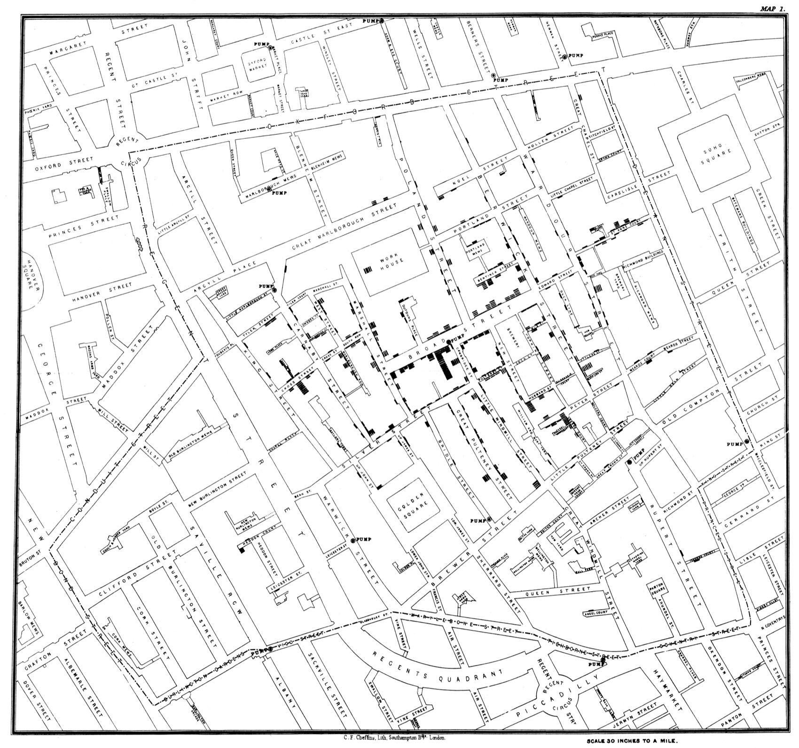
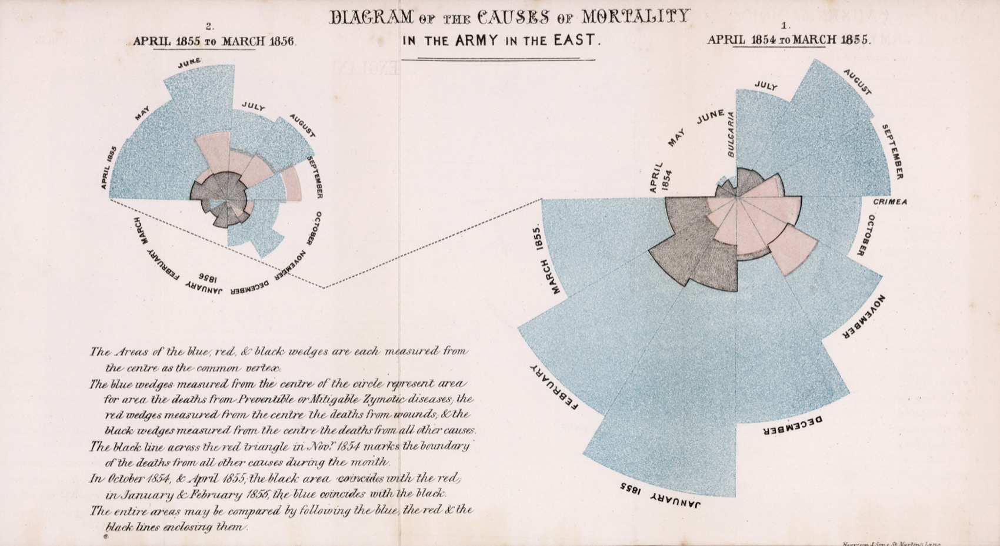
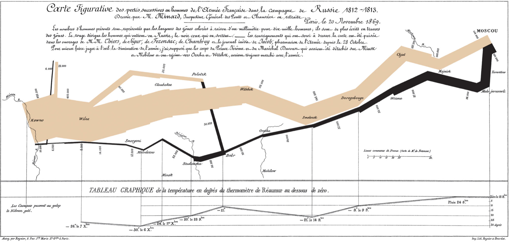

## Before class (the flip)

:::: {.two-col}
::: {.activity-card}
[Bring · 20 minutes at home]{.card-title}

1. **One A3 output**: a table, chart, map, or model result.
2. **Two diagram briefs** from your own project, written for someone else to draw. Use the brief format on the next slide.
3. Spend five minutes with the [Threshold Explorer](../site_tools/threshold-explorer.html). Move one slider until the recommendation changes.
:::

::: {.concept-card}
[In class, we do not lecture at you]{.card-title}

- **Session 1:** we look at drawn threshold diagrams and argue about where the lines are.
- **Session 2:** you draw each other's briefs three ways (hand, AI, data tool) and compare.
- Three of us: two students and the instructor. The instructor writes two briefs too and is drawn, judged, and challenged like everyone else.
:::
::::

---

## The brief you bring (×2)

Write it so a classmate who does not know your project could draw it.

| Field | What to write |
|---|---|
| **Decision** | the choice this diagram supports, in one line |
| **Data** | the numbers, or a pasted table / CSV (10 rows or fewer) |
| **Threshold** | the line, its unit, and where it came from: code, precedent, client, physics, or my guess |
| **Audience** | who looks at it, and for how long (e.g. client, 30 s) |
| **Must show** | the one thing the reader must see at a glance |

[If you cannot write the threshold line, that *is* your finding for this week. Bring it anyway.]{.ask-room}

---

## 1986: the line nobody drew

[Session 1 · Where is the line?]{.kicker}

::: {.diagram}
```{=html}
<svg viewBox="0 0 1200 440" role="img" aria-label="Shuttle flights before Challenger plotted by launch temperature, showing no prior flight below 53 degrees F and the Challenger launch at 36 degrees F">
  <rect x="80" y="40" width="504" height="320" fill="var(--warn-soft)"/>
  <text x="96" y="74" font-size="20" fill="var(--role-warn)" font-weight="600">No flight had ever launched this cold</text>
  <line x1="584" y1="40" x2="584" y2="370" stroke="var(--ink)" stroke-width="2" stroke-dasharray="7 6"/>
  <text x="594" y="62" font-size="18" fill="var(--ink)">coldest prior launch · 53°F</text>
  <line x1="278" y1="96" x2="278" y2="370" stroke="var(--signal)" stroke-width="4"/>
  <text x="290" y="122" font-size="22" fill="var(--signal)" font-weight="700">Challenger · 36°F</text>
  <text x="290" y="148" font-size="17" fill="var(--signal)">28 January 1986</text>
  <text x="1160" y="138" font-size="17" fill="var(--muted)" text-anchor="end">flights with O-ring damage</text>
  <text x="1160" y="356" font-size="17" fill="var(--muted)" text-anchor="end">flights without damage</text>
  <g fill="var(--role-warn)">
    <circle cx="584" cy="190" r="9"/><circle cx="656" cy="190" r="9"/><circle cx="674" cy="190" r="9"/>
    <circle cx="764" cy="190" r="9"/><circle cx="890" cy="190" r="9"/><circle cx="890" cy="168" r="9"/>
    <circle cx="980" cy="190" r="9"/>
  </g>
  <g fill="var(--paper)" stroke="var(--ink)" stroke-width="2">
    <circle cx="818" cy="320" r="8"/><circle cx="836" cy="320" r="8"/><circle cx="836" cy="298" r="8"/><circle cx="836" cy="276" r="8"/>
    <circle cx="854" cy="320" r="8"/><circle cx="872" cy="320" r="8"/><circle cx="890" cy="320" r="8"/><circle cx="890" cy="298" r="8"/>
    <circle cx="926" cy="320" r="8"/><circle cx="944" cy="320" r="8"/><circle cx="980" cy="320" r="8"/><circle cx="998" cy="320" r="8"/>
    <circle cx="998" cy="298" r="8"/><circle cx="1034" cy="320" r="8"/><circle cx="1052" cy="320" r="8"/><circle cx="1088" cy="320" r="8"/>
  </g>
  <line x1="80" y1="370" x2="1160" y2="370" stroke="var(--ink)" stroke-width="1.5"/>
  <g font-size="18" fill="var(--muted)" text-anchor="middle">
    <text x="170" y="398">30°F</text><text x="350" y="398">40</text><text x="530" y="398">50</text>
    <text x="710" y="398">60</text><text x="890" y="398">70</text><text x="1070" y="398">80</text>
  </g>
  <text x="620" y="432" font-size="17" fill="var(--muted)" text-anchor="middle">launch temperature</text>
</svg>
```
[Schematic redraw of the 23 earlier flights, after Dalal, Fowlkes &amp; Hoadley (1989) and Tufte (1997). The engineers' real charts never put temperature on an axis.]{.src}
:::

[The threshold was there in the data: 53°F was the edge of experience. Why did no chart draw it?]{.ask-room}

---

## Draw the line · live (10 min)

Open the [Threshold Explorer](../site_tools/threshold-explorer.html) on **your own device**. Tick **Blind mode**. Set all five thresholds alone, with no talking. Then reveal together.

<iframe class="xlsx-preview-frame" src="../site_tools/threshold-explorer.html" title="Threshold Explorer"></iframe>

[Same data, same rules. Did we all recommend the same facade? If not, where did the disagreement live: in the data or in the lines?]{.ask-room}

---

## The knife edge: 0.4 over a line

::: {.diagram}
```{=html}
<svg viewBox="0 0 1200 430" role="img" aria-label="Solar gain proxy strip plot for five facade variants, drawn twice: with a hard line High greenery fails; with an uncertainty band it is under review">
  <text x="80" y="40" font-size="20" font-weight="700" fill="var(--ink)">A · Hard lines on all five criteria</text>
  <rect x="80" y="92" width="460" height="28" fill="var(--activity-soft)"/>
  <line x1="80" y1="106" x2="1080" y2="106" stroke="var(--rule-soft)" stroke-width="2"/>
  <line x1="540" y1="70" x2="540" y2="140" stroke="var(--signal)" stroke-width="4"/>
  <text x="540" y="62" font-size="17" fill="var(--signal)" text-anchor="middle" font-weight="600">≤ 48.0</text>
  <g font-size="16" fill="var(--muted)" text-anchor="middle">
    <circle cx="206" cy="106" r="10" fill="var(--role-activity)"/><text x="206" y="150">Deep fins</text>
    <circle cx="328" cy="106" r="10" fill="var(--role-activity)"/><text x="328" y="150">Compact</text>
    <circle cx="438" cy="106" r="12" fill="var(--role-activity)" stroke="var(--ink)" stroke-width="2"/><text x="438" y="150" fill="var(--ink)" font-weight="700">Hybrid</text>
    <circle cx="548" cy="106" r="10" fill="var(--role-warn)"/><text x="600" y="150" fill="var(--role-warn)" font-weight="700">High greenery · fail</text>
    <circle cx="1020" cy="106" r="10" fill="var(--role-warn)"/><text x="1020" y="150">Baseline</text>
  </g>
  <text x="1160" y="40" font-size="18" fill="var(--role-warn)" text-anchor="end" font-weight="700">High greenery: score 30 → revise</text>

  <text x="80" y="232" font-size="20" font-weight="700" fill="var(--ink)">B · Same lines + Week 3 review bands (solar: +10%)</text>
  <rect x="80" y="284" width="460" height="28" fill="var(--activity-soft)"/>
  <rect x="540" y="284" width="96" height="28" fill="var(--example-soft)"/>
  <line x1="80" y1="298" x2="1080" y2="298" stroke="var(--rule-soft)" stroke-width="2"/>
  <line x1="540" y1="262" x2="540" y2="332" stroke="var(--signal)" stroke-width="4"/>
  <line x1="636" y1="270" x2="636" y2="326" stroke="var(--role-example)" stroke-width="2" stroke-dasharray="5 4"/>
  <text x="588" y="254" font-size="16" fill="var(--role-example)" text-anchor="middle">review band to 52.8</text>
  <g font-size="16" fill="var(--muted)" text-anchor="middle">
    <circle cx="206" cy="298" r="10" fill="var(--role-activity)"/>
    <circle cx="328" cy="298" r="10" fill="var(--role-activity)"/>
    <circle cx="438" cy="298" r="12" fill="var(--role-activity)" stroke="var(--ink)" stroke-width="2"/>
    <circle cx="548" cy="298" r="10" fill="var(--role-example)"/><text x="600" y="346" fill="var(--role-example)" font-weight="700">High greenery · review</text>
    <circle cx="1020" cy="298" r="10" fill="var(--role-warn)"/>
  </g>
  <text x="1160" y="232" font-size="18" fill="var(--role-example)" text-anchor="end" font-weight="700">High greenery: score 55 → review</text>

  <line x1="80" y1="380" x2="1080" y2="380" stroke="var(--ink)" stroke-width="1.5"/>
  <g font-size="16" fill="var(--muted)" text-anchor="middle">
    <text x="180" y="404">30</text><text x="380" y="404">40</text><text x="580" y="404">50</text>
    <text x="780" y="404">60</text><text x="980" y="404">70</text>
  </g>
  <text x="580" y="426" font-size="16" fill="var(--muted)" text-anchor="middle">solar gain proxy (index, lower is better) · confidence for High greenery: LOW</text>
</svg>
```
[Week 3 facade data · `starter_kits/spreadsheet-thresholds/decision_matrix_filled_example.csv`]{.src}
:::

[Same number (48.4), two pictures, two verdicts. Which one is honest about a low-confidence proxy?]{.ask-room}

---

## Which lines are actually worth defending?

::: {.diagram}
```{=html}
<svg viewBox="0 0 1200 400" role="img" aria-label="Bar chart of how far each threshold must tighten before Hybrid stops being the top recommendation">
  <text x="330" y="30" font-size="18" fill="var(--muted)">how far the threshold must tighten before Hybrid stops being the top pick</text>
  <g font-size="20" text-anchor="end">
    <text x="310" y="90" fill="var(--ink)" font-weight="700">facade depth ≤ 0.75 m</text>
    <text x="310" y="150" fill="var(--ink)" font-weight="700">solar gain ≤ 48.0</text>
    <text x="310" y="210" fill="var(--muted)">morning glare ≤ 2.0 h</text>
    <text x="310" y="270" fill="var(--muted)">view openness ≥ 0.55</text>
    <text x="310" y="330" fill="var(--muted)">planting depth ≥ 0.80 m</text>
  </g>
  <rect x="330" y="68" width="283" height="32" fill="var(--signal)"/>
  <text x="625" y="91" font-size="19" fill="var(--signal)" font-weight="700">−18% (to 0.62 m) → Deep fins wins</text>
  <rect x="330" y="128" width="304" height="32" fill="var(--signal)"/>
  <text x="646" y="151" font-size="19" fill="var(--signal)" font-weight="700">−19% (to 38.9) → Deep fins wins</text>
  <defs>
    <pattern id="w9hatch" width="10" height="10" patternUnits="userSpaceOnUse" patternTransform="rotate(45)">
      <rect width="10" height="10" fill="var(--rule-soft)"/><line x1="0" y1="0" x2="0" y2="10" stroke="var(--paper)" stroke-width="4"/>
    </pattern>
  </defs>
  <rect x="330" y="188" width="800" height="32" fill="url(#w9hatch)"/>
  <rect x="330" y="248" width="800" height="32" fill="url(#w9hatch)"/>
  <rect x="330" y="308" width="800" height="32" fill="url(#w9hatch)"/>
  <text x="1120" y="270" font-size="17" fill="var(--muted)" text-anchor="end">no move in the tested range changes the pick</text>
  <line x1="330" y1="356" x2="1130" y2="356" stroke="var(--ink)" stroke-width="1.5"/>
  <g font-size="16" fill="var(--muted)" text-anchor="middle">
    <text x="330" y="380">0%</text><text x="490" y="380">10%</text><text x="650" y="380">20%</text>
    <text x="810" y="380">30%</text><text x="970" y="380">40%</text><text x="1130" y="380">50%</text>
  </g>
</svg>
```
[Computed by the Threshold Explorer (“flip” readout) on the Week 3 rules]{.src}
:::

[Five thresholds, but only two can change the answer. Which two belong on the object card, and which three can go in a footnote?]{.ask-room}

---

## A line on a map is a ring. People walk streets.

::: {.diagram}
```{=html}
<svg viewBox="0 0 1200 500" role="img" aria-label="Illustrative map: a home 680 metres from a station in a straight line sits inside the 800 metre ring, but a highway forces a 2.1 kilometre walk">
  <g stroke="var(--rule-soft)" stroke-width="1">
    <line x1="160" y1="40" x2="160" y2="490"/><line x1="240" y1="40" x2="240" y2="490"/><line x1="320" y1="40" x2="320" y2="490"/>
    <line x1="420" y1="40" x2="420" y2="490"/><line x1="600" y1="40" x2="600" y2="490"/><line x1="680" y1="40" x2="680" y2="490"/>
    <line x1="140" y1="100" x2="700" y2="100"/><line x1="140" y1="170" x2="700" y2="170"/><line x1="140" y1="270" x2="700" y2="270"/>
    <line x1="140" y1="360" x2="700" y2="360"/><line x1="140" y1="440" x2="700" y2="440"/>
  </g>
  <rect x="512" y="30" width="36" height="400" fill="var(--ink)" opacity="0.82"/>
  <rect x="512" y="452" width="36" height="40" fill="var(--ink)" opacity="0.82"/>
  <text x="530" y="24" font-size="15" fill="var(--ink)" text-anchor="middle">highway</text>
  <text x="556" y="482" font-size="14" fill="var(--muted)">bridge</text>
  <circle cx="420" cy="270" r="110" fill="none" stroke="var(--signal)" stroke-width="2" stroke-dasharray="6 6"/>
  <circle cx="420" cy="270" r="220" fill="none" stroke="var(--signal)" stroke-width="3"/>
  <text x="420" y="44" font-size="16" fill="var(--signal)" text-anchor="middle" font-weight="600">800 m ring</text>
  <text x="420" y="154" font-size="14" fill="var(--signal)" text-anchor="middle">400 m</text>
  <polyline points="600,220 600,441 420,441 420,270" fill="none" stroke="var(--role-concept)" stroke-width="5" stroke-linejoin="round"/>
  <line x1="420" y1="270" x2="600" y2="220" stroke="var(--muted)" stroke-width="2" stroke-dasharray="3 5"/>
  <rect x="408" y="258" width="24" height="24" fill="var(--ink)"/>
  <text x="380" y="300" font-size="16" fill="var(--ink)" text-anchor="end" font-weight="700">station</text>
  <circle cx="600" cy="220" r="12" fill="var(--role-warn)"/>
  <text x="618" y="214" font-size="17" fill="var(--role-warn)" font-weight="700">home</text>
  <circle cx="300" cy="150" r="10" fill="var(--role-activity)"/>
  <circle cx="250" cy="360" r="10" fill="var(--role-activity)"/>
  <g font-size="20">
    <text x="760" y="140" fill="var(--muted)">straight line</text>
    <text x="760" y="172" fill="var(--ink)" font-weight="700">680 m · inside the ring ✓</text>
    <text x="760" y="240" fill="var(--role-concept)">on foot, via the bridge</text>
    <text x="760" y="272" fill="var(--role-concept)" font-weight="700">≈ 2.1 km · ≈ 25 min ✗</text>
    <text x="760" y="350" fill="var(--ink)">The threshold (800 m) was fine.</text>
    <text x="760" y="380" fill="var(--signal)" font-weight="700">The way it was measured was not.</text>
  </g>
</svg>
```
[Illustrative site. 400 m / 800 m are common planning rules of thumb for walking catchments, not a Hong Kong standard.]{.src}
:::

[Draw this line for a 75-year-old walking at half speed. Does the ring shrink, or does the line move?]{.ask-room}

---

## Same air, four lines

::: {.diagram}
```{=html}
<svg viewBox="0 0 1200 460" role="img" aria-label="Annual PM2.5 thresholds: Hong Kong before 2022 at 35, Hong Kong from 2022 at 25, WHO 2005 at 10, WHO 2021 at 5, with an illustrative site at 20">
  <line x1="140" y1="40" x2="140" y2="400" stroke="var(--ink)" stroke-width="1.5"/>
  <g font-size="16" fill="var(--muted)" text-anchor="end">
    <text x="128" y="405">0</text><text x="128" y="315">10</text><text x="128" y="225">20</text><text x="128" y="135">30</text><text x="128" y="45">40</text>
  </g>
  <text x="60" y="230" font-size="16" fill="var(--muted)" transform="rotate(-90 60 230)" text-anchor="middle">annual PM2.5 (µg/m³)</text>
  <line x1="140" y1="85" x2="880" y2="85" stroke="var(--role-activity)" stroke-width="3" stroke-dasharray="8 6"/>
  <line x1="140" y1="175" x2="880" y2="175" stroke="var(--role-activity)" stroke-width="4"/>
  <line x1="140" y1="310" x2="880" y2="310" stroke="var(--role-warn)" stroke-width="3" stroke-dasharray="8 6"/>
  <line x1="140" y1="355" x2="880" y2="355" stroke="var(--role-warn)" stroke-width="4"/>
  <g font-size="18">
    <text x="895" y="91" fill="var(--role-activity)">35 · Hong Kong AQO, before 2022</text>
    <text x="895" y="181" fill="var(--role-activity)" font-weight="700">25 · Hong Kong AQO, from 2022</text>
    <text x="895" y="316" fill="var(--role-warn)">10 · WHO guideline, 2005</text>
    <text x="895" y="361" fill="var(--role-warn)" font-weight="700">5 · WHO guideline, 2021</text>
  </g>
  <circle cx="510" cy="220" r="14" fill="var(--signal)"/>
  <text x="535" y="214" font-size="20" fill="var(--signal)" font-weight="700">your site: 20</text>
  <text x="535" y="240" font-size="15" fill="var(--muted)">(illustrative value)</text>
  <text x="160" y="440" font-size="17" fill="var(--ink)">Passes both Hong Kong lines. 2× the 2005 WHO line. <tspan fill="var(--signal)" font-weight="700">4× the 2021 WHO line.</tspan></text>
</svg>
```
[WHO Global Air Quality Guidelines (2021); HK EPD Air Quality Objectives (in force 1 Jan 2022). In the same revision the HK 24-hour limit tightened from 75 to 50 µg/m³, but allowed exceedances rose from 9 to 35 a year.]{.src}
:::

[Write a recommendation for this site that is true under all four lines. Is a threshold just a number, or a number plus a counting rule?]{.ask-room}

---

## 1854: Snow drew a walking-distance line

[Old figures, read for their lines]{.kicker}

::: {.vibe-case}
::: {.vibe-visual}

:::
::: {.vibe-panel}
::: {.example-card}
[Threshold in the picture]{.card-title}
In a later version made for the parish inquiry (not the one shown), Snow added a dotted boundary: the points that were **equally far on foot** from the Broad Street pump and from the next nearest pump. The deaths sat inside the line.
:::

[Snow's boundary followed streets, not a circle. Compare it with the ring on our map two slides back.]{.ask-room}
:::
:::

---

## 1858: Nightingale made the comparison the line

::: {.vibe-case}
::: {.vibe-visual}

:::
::: {.vibe-panel}
::: {.example-card}
[Threshold in the picture]{.card-title}
There is no number to clear. The line is relative: preventable disease against wounds. When the outer wedge dwarfs the inner one, the case is made.
:::

[Your threshold could be relative ("better than baseline by X") instead of absolute. Which would your audience trust more?]{.ask-room}
:::
:::

---

## 1869: Minard put the cold on its own axis

::: {.vibe-case}
::: {.vibe-visual}

:::
::: {.vibe-panel}
::: {.example-card}
[Threshold in the picture]{.card-title}
The temperature line along the bottom is tied to the shrinking army above it. You can see the band collapse as the cold drops. Challenger's charts were missing exactly this axis.
:::

[What is the "temperature line" in your project: the variable that, once it crosses a value, changes everything?]{.ask-room}
:::
:::

---

## A menu of threshold diagrams

::: {.diagram}
```{=html}
<svg viewBox="0 0 1200 250" role="img" aria-label="Five small threshold diagram patterns">
  <g>
    <rect x="0" y="0" width="216" height="170" fill="#fff" stroke="var(--rule-soft)"/>
    <rect x="12" y="80" width="98" height="20" fill="var(--activity-soft)"/>
    <line x1="12" y1="90" x2="204" y2="90" stroke="var(--rule-soft)" stroke-width="2"/>
    <line x1="110" y1="55" x2="110" y2="125" stroke="var(--signal)" stroke-width="3"/>
    <circle cx="40" cy="90" r="7" fill="var(--role-activity)"/><circle cx="75" cy="90" r="7" fill="var(--role-activity)"/>
    <circle cx="100" cy="90" r="7" fill="var(--role-activity)"/><circle cx="126" cy="90" r="7" fill="var(--role-warn)"/><circle cx="182" cy="90" r="7" fill="var(--role-warn)"/>
    <text x="108" y="200" font-size="19" font-weight="700" text-anchor="middle" fill="var(--ink)">Line on a strip</text>
    <text x="108" y="224" font-size="15" text-anchor="middle" fill="var(--muted)">few options, one metric</text>
  </g>
  <g transform="translate(246,0)">
    <rect x="0" y="0" width="216" height="170" fill="#fff" stroke="var(--rule-soft)"/>
    <rect x="12" y="80" width="98" height="20" fill="var(--activity-soft)"/>
    <rect x="110" y="80" width="34" height="20" fill="var(--example-soft)"/>
    <line x1="12" y1="90" x2="204" y2="90" stroke="var(--rule-soft)" stroke-width="2"/>
    <line x1="110" y1="55" x2="110" y2="125" stroke="var(--signal)" stroke-width="3"/>
    <circle cx="60" cy="90" r="7" fill="var(--role-activity)"/><circle cx="126" cy="90" r="7" fill="var(--role-example)"/><circle cx="182" cy="90" r="7" fill="var(--role-warn)"/>
    <text x="108" y="200" font-size="19" font-weight="700" text-anchor="middle" fill="var(--ink)">Band, not a line</text>
    <text x="108" y="224" font-size="15" text-anchor="middle" fill="var(--muted)">uncertain or proxy data</text>
  </g>
  <g transform="translate(492,0)">
    <rect x="0" y="0" width="216" height="170" fill="#fff" stroke="var(--rule-soft)"/>
    <circle cx="96" cy="85" r="62" fill="none" stroke="var(--signal)" stroke-width="3"/>
    <rect x="88" y="77" width="16" height="16" fill="var(--ink)"/>
    <rect x="150" y="8" width="12" height="154" fill="var(--ink)" opacity="0.8"/>
    <circle cx="60" cy="60" r="6" fill="var(--role-activity)"/><circle cx="72" cy="120" r="6" fill="var(--role-activity)"/>
    <circle cx="140" cy="60" r="6" fill="var(--role-activity)"/><circle cx="178" cy="70" r="6" fill="var(--role-warn)"/>
    <text x="108" y="200" font-size="19" font-weight="700" text-anchor="middle" fill="var(--ink)">Ring on a map</text>
    <text x="108" y="224" font-size="15" text-anchor="middle" fill="var(--muted)">distance and access</text>
  </g>
  <g transform="translate(738,0)">
    <rect x="0" y="0" width="216" height="170" fill="#fff" stroke="var(--rule-soft)"/>
    <line x1="16" y1="30" x2="200" y2="30" stroke="var(--role-activity)" stroke-width="3"/>
    <line x1="16" y1="60" x2="200" y2="60" stroke="var(--role-activity)" stroke-width="3"/>
    <line x1="16" y1="118" x2="200" y2="118" stroke="var(--role-warn)" stroke-width="3"/>
    <line x1="16" y1="145" x2="200" y2="145" stroke="var(--role-warn)" stroke-width="3"/>
    <circle cx="108" cy="88" r="9" fill="var(--signal)"/>
    <text x="108" y="200" font-size="19" font-weight="700" text-anchor="middle" fill="var(--ink)">Ladder of lines</text>
    <text x="108" y="224" font-size="15" text-anchor="middle" fill="var(--muted)">competing standards</text>
  </g>
  <g transform="translate(984,0)">
    <rect x="0" y="0" width="216" height="170" fill="#fff" stroke="var(--rule-soft)"/>
    <rect x="16" y="22" width="70" height="20" fill="var(--signal)"/>
    <rect x="16" y="54" width="80" height="20" fill="var(--signal)"/>
    <rect x="16" y="86" width="184" height="20" fill="var(--rule-soft)"/>
    <rect x="16" y="118" width="184" height="20" fill="var(--rule-soft)"/>
    <text x="108" y="200" font-size="19" font-weight="700" text-anchor="middle" fill="var(--ink)">How far to flip</text>
    <text x="108" y="224" font-size="15" text-anchor="middle" fill="var(--muted)">which lines matter</text>
  </g>
</svg>
```
:::

Every pattern draws the line *inside* the figure. A threshold that only appears in a caption is a threshold the reader will miss.

[Which pattern fits your brief? Is there a sixth one we have not drawn?]{.ask-room}

---

## BREAK {.big-break}

Ten minutes. Put both of your briefs in Slack before we restart.

---

## Your brief, drawn by someone else, three ways

[Session 2 · Swap studio]{.kicker}

::: {.spine-rail}
[Decision]{.node} [Evidence]{.node} [Variation]{.node} [Output]{.node} [Threshold]{.node .is-current} [Action]{.node}
:::

**Swap ring:** Student 1 → Student 2 → Instructor → Student 1. You draw the **Brief 1** of the next person in the ring, and your own brief comes back to you drawn three ways. If another student attends, they join the ring.

::: {.three-step}
::: {.step-box}
**1 · By hand · 8 min**

Paper and two pens: black plus one colour for the line. No software. Sketch fast, but the threshold must be drawn in.
:::
::: {.step-box}
**2 · With AI · 10 min**

Any chat or image tool. Paste the brief. Save the prompt and every output, including the bad ones.
:::
::: {.step-box}
**3 · From the data · 10 min**

Spreadsheet chart, the Threshold Explorer, or AI-written Python **that you run**. The numbers must come from the brief.
:::
:::

[Brief 2 goes round the ring in reverse as the exit task: one route of your choice.]{.feeds-tag}

---

## Prompt starter for round 2

::: {.concept-card}
[Paste into any AI tool, then paste your brief]{.card-title}
"You are drawing a decision diagram for an architecture audience. Draw **one** figure in which the threshold is a visible line or band inside the plot, the options are labelled directly (no legend), and the title states the takeaway. Use **only** the numbers in my brief. If you need a number that is not there, ask me. If you can, give me Python/matplotlib code instead of an image."
:::

:::: {.two-col}
::: {.warning-card}
[Image generators draw pictures *of* charts]{.card-title}
They can invent ticks, nudge the line, or round 48.4 down to "under 48". Fine for a layout sketch, but never as evidence.
:::
::: {.concept-card}
[Code is checkable]{.card-title}
A chart made by code you ran is a Week 8 "workflow/code" output: run it, check the units, and test it with one known value.
:::
::::

---

## Compare: lay out all nine

Put every drawing in Slack. **The brief's author** judges their own three versions; everyone else adds one note.

| Check | Hand | AI | Data |
|---|---|---|---|
| **3-second test:** can you tell what's compared and who wins? | | | |
| Is the **threshold drawn** at the right value, in the right unit? | | | |
| Is **uncertainty** visible (band, range, confidence)? | | | |
| Did anything get **invented** (numbers, options, labels)? | | | |
| Which **one** goes on your object card, and what would you steal from the others? | | | |

[Which route told the story best, and was it the same route that got the numbers right?]{.ask-room}

---

## Defend one line (5 min each)

Each author takes one threshold from their winning diagram. The other two each take one role and attack it once. Rotate roles each round so everyone plays all three.

:::: {.two-col}
::: {.concept-card}
[Roles]{.card-title}

- **Client:** "That line costs me money."
- **Occupant:** "That line leaves me out."
- **Regulator:** "Where did that number come from?"
:::

::: {.activity-card}
[Author answers with three things]{.card-title}

1. the source: code, precedent, client, physics, or my guess
2. how far it can move before the recommendation flips
3. what evidence would make you move it
:::
::::

---

## The sentence that goes on the card

::: {.concept-card}
[Recommendation sentence, Week 9 version]{.card-title}
**For [audience], I recommend [option] because it clears [threshold] ([source]). This changes if [threshold] moves by [how much] or if [counter-argument] holds.**
:::

::: {.example-card}
[Worked from today's facade data]{.card-title}
For the client team, I recommend **Hybrid** because it passes all five thresholds in our Week 3 matrix. This changes to **Deep fins** if the solar gain line tightens by about 19% (to ≤ 38.9) or the depth allowance drops below about 0.62 m.
:::

---

## Reconstruct your threshold diagram in four steps

**Object this week: the diagram of your own brief that you chose, and the line inside it.**

::: {.recall-4step}
::: {.step}
**Did** Which version did you choose (hand, AI, or data), and what is its one message?
:::
::: {.step}
**Assumed** Where does the line come from, and who chose it?
:::
::: {.step}
**Risk** How far can it move before the recommendation flips? What did AI get wrong?
:::
::: {.step}
**Verify** Which number in the figure did you check against the brief?
:::
:::

::: {.grading-note}
Post the four steps under your chosen diagram in Slack. The graded unit is the posting plus an honest reconstruction, not how well you spoke.
:::

---

## Exit · before Week 10

:::: {.two-col}
::: {.reflection-card}
[Bring]{.card-title}

- **Brief 2**, drawn one way, for the classmate it was assigned to
- your chosen threshold diagram, revised
- your recommendation sentence, including the flip distance
- **A3 is due this week.** A4 starts now: the diagram and sentence become your Object Card draft.
:::

::: {.activity-card}
[Weeks 10–11, with two students]{.card-title}
No vote needed. Each of you writes one line in Slack: **clinic** (1-1 help finishing A4) or **workgroup** (building your own GH/Python pipeline). With two of you, we can run both modes side by side.
:::
::::
