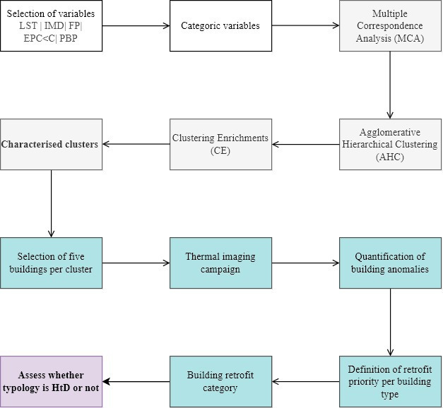
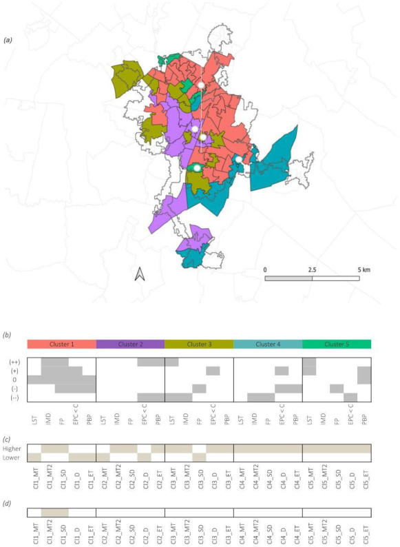

## Today

:::: {.columns}
::: {.column width="50%"}
### Session 1 · 50 min

- **0–3** Why a literature check, and why now
- **3–13** Did Week 10's feedback land?
- **13–17** Write down your claim, before reading
- **17–31** Regex from zero
- **31–44** OpenAlex, and where PRISMA fits
- **44–50** Worked example: one paper, two readings
:::
::: {.column width="50%"}
### Session 2 · 50 min

- **0–16** Read your paper and rewrite the claim
- **16–28** Four evidence clinics
- **28–40** The final package, walked through
- **40–48** Fix one thing, log it
- **48–50** Next week: quick-fire and the LLM judge
:::
::::

::: {.punch .blue}
Bring: your Week 10 Peer Review Card, your Revision Ledger, one claim and its source.
:::

::: notes
Four students: two PhD, two undergraduate. Everyone does the same tasks on their own project. A4 is due at the end of Week 12, so every activity today should leave a change in the package.
:::

## Why a literature check, and why now?

::: {.big}
This isn't a new literature-review assignment. It's the **Week 2 evidence audit**, applied to the one kind of source we haven't inspected yet: **published papers**.
:::

::: {.fragment .big}
- A4's Research Brief must name its **input sources**.
- **Evidence quality and uncertainty** is 20% of the A4 mark.
- The brief's first listed failure mode: *"making stronger claims than the evidence supports"*.
:::

::: {.fragment .punch}
Papers are the evidence most often cited from the abstract alone. One claim, one source, read properly.
:::

::: notes
Week 2's ladder put "well-matched comparative evidence" near the top and "a single relevant precedent" in the middle, strong only if assumptions and context hold. A published study is exactly that: strong for its own conditions, and today's question is whether those conditions match the student's project.
:::

---

## Where today sits in your workflow

:::: {.flow}
::: {.step}
**Find**\
OpenAlex: the record, a free PDF, what cites it
:::
::: {.step}
**Read**\
full text: methods, results, limitations
:::
::: {.step}
**Check**\
regex over text and files
:::
::: {.step}
**Record**\
Brief, capsule source list, ledger
:::
::::

::: {.big}
**Week 2** audited your evidence · **Week 8** reran your workflow and fact-checked AI · **Week 10** reviewed each other's work · **Week 11** checks the published sources · **Week 12** checks an AI critic.
:::

::: {.punch .blue}
The same question each time: what does this evidence actually support?
:::

# Did last week's feedback land? {background-color="#1a1a1a"}

---

## Week 10 → your A4, today

[3–13 min · 2½ min each]{.timer}

::: {.big}
1. Show the **one piece of advice** you got from your Week 10 reviewer.
2. Show the **ledger entry** you wrote for it.
3. Show **where it changed** the package: file, page or figure.
:::

::: {.fragment}
Your Week 10 reviewer answers one question:

::: {.punch}
"Is that what I meant?"
:::
:::

::: notes
This is a receipt check, not a second review. If the reviewer says "not quite", the author writes one line in the ledger clarifying the advice; they don't redo the work now. Keep strictly to 2.5 minutes.
:::

---

## Three honest answers

| Status | What you show |
|---|---|
| **Addressed** | The changed page or figure, next to the advice |
| **In progress** | What you have done, and what still remains before Week 12 |
| **Deferred or rejected** | The reason, written in the ledger |

::: {.box .big}
"The advice was \_\_\_. I **addressed / am working on / deferred** it: \_\_\_. You can see it in \_\_\_."
:::

::: {.punch .green}
A reasoned rejection counts as a ledger entry. Silence doesn't.
:::

# Your claim, before you read {background-color="#1a1a1a"}

---

## Write it down first

[13–17 min · on the worksheet]{.timer}

::: {.big}
Pick **one claim** your project relies on, and the source you rely on for it.

Read **only the abstract**, then write:
:::

::: {.box .big}
"The abstract says \_\_\_. I took it to mean \_\_\_ for my project, so I was going to \_\_\_."
:::

::: {.src}
PhD: a research premise or method choice. Studio: a design decision. A guideline, standard or published precedent is a valid source if that is what your decision rests on. [Evidence Clinic Worksheet (PDF)](../templates/evidence-clinic-worksheet.pdf)
:::

::: notes
We do this before the tool block on purpose: the "before" reading has to be written down before anyone opens the full text. If a student already knows the paper well, they write what they would have assumed from the abstract alone.
:::

# Regex from zero {background-color="#1a1a1a"}

---

## A find box that understands patterns

::: {.big}
**Regex** (regular expression) is a short rule that describes a *pattern* of characters, not a fixed word.

You can use it in:

- **VS Code**: Find, then the `.*` button
- **Python**: `re.findall(r"pattern", text)`
- **Google Sheets**: `=REGEXMATCH(A2, "pattern")`
- the course **[Regex Lab](../site_tools/regex-lab.html)**
:::

::: {.punch}
It doesn't work in Google's search box. That has its own operators.
:::

---

## Where you'll actually use it

| Job in your project | Example pattern |
|---|---|
| **Capsule:** check every exported variant file follows the README's naming rule | `^variant_\d{2}\.csv$` |
| **Reading:** find every temperature reported in a paper's text | `\d+(\.\d+)?\s?°C` |
| **Data:** pull the number out of a messy column ("approx. 0.62 WWR") | `=REGEXEXTRACT(A2, "\d+\.?\d*")` in Sheets |
| **Literature (PhD):** flag records in an export that mention your method | `\bthermal imag[a-z]*` with `i` |

::: {.punch .blue}
Ten minutes of regex can save an hour of scrolling, but only if you check what it missed.
:::

---

## Plain text matches plain text

Four lines of notes:

```text
Shade at the entrance.
The shaded bench.
SHADING along the facade.
A shadow line.
```

::: {.fragment}
Pattern `shade`: predict the matches.
:::

::: {.fragment .big}
One match: the **shade** inside "**shade**d". It misses "Shade" and "SHADING", because matching is case-sensitive by default.
:::

::: {.fragment .punch .blue}
Add the flag `i` (ignore case) and "Shade" joins it. "SHADING" still doesn't, since it doesn't contain "shade".
:::

---

## `\b` marks the edge of a word

```text
\bshade\b      with flag i
```

::: {.big}
`\b` means "a word starts or ends here".
:::

::: {.fragment .big}
Now: **Shade** ✓ · shaded ✗ · SHADING ✗ · shadow ✗
:::

::: {.fragment .punch}
Stricter, but now the forms we wanted are missing too.
:::

---

## `( | )` means either / or

```text
\bshad(e|ed|ing)\b      with flag i
```

::: {.big}
"shad", followed by **e**, **ed** or **ing**, then the end of a word.
:::

::: {.fragment .big}
**Shade** ✓ · **shaded** ✓ · **SHADING** ✓ · shadow ✗
:::

::: {.fragment .punch .green}
You've just written a search for one design term in every form you care about.
:::

---

## Digits and how many

| Piece | Means |
|---|---|
| `\d` | one digit, 0–9 |
| `+` | one or more of the thing before it |
| `?` | the thing before it is optional |
| `{2}` | exactly two of the thing before it |
| `\.` | a real full stop (a bare `.` means *any* character) |
| `\s` | a space |

::: {.fragment}
```text
\d+(\.\d+)?\s?°C
```
Digits, an optional decimal part, an optional space, then °C.
:::

---

## Pull the temperatures out of your notes

```text
Wall difference above 2°C suggests a higher retrofit need.
A 2.5 °C difference at the window frame.
25 buildings were surveyed.
The 0.5 K drift is sensor noise.
```

::: {.fragment .big}
Matches: **2°C** and **2.5 °C**. Not "25 buildings", not "0.5 K".
:::

::: {.fragment .punch .blue}
Useful for scanning a long PDF's text for every reported value, before you check what each one refers to.
:::

---

## `^` and `$`: the whole line, nothing else

```text
^variant_\d{2}\.csv$      with flag m (each line separately)
```

| File | Passes? |
|---|---|
| `variant_01.csv` | ✓ |
| `variant_1.csv` | ✗ only one digit |
| `Variant_03.csv` | ✗ capital V |
| `variant_04.csv.bak` | ✗ something after `.csv` |

::: {.fragment .punch}
Drop the `\` before `.csv` and `variant_05xcsv` passes too. `.` means any character.
:::

::: notes
This is the practical use for the capsule: check that every exported variant file follows the naming rule your README promises.
:::

---

## Parentheses also *capture*

A reference export (RIS) puts each field on its own tagged line:

```text
TY  - JOUR
DO  - 10.1098/rsos.241337
ER  -
```

```text
^DO  - (.+)$      with flag m
```

::: {.fragment .big}
The part inside `( )` is returned on its own: **10.1098/rsos.241337**, the DOI.
:::

::: {.src}
For whole reference libraries, use a reference manager or a RIS parser. Regex is for one specific clean-up. [ScienceDirect export help](https://www.elsevier.support/sciencedirect/answer/how-can-i-export-my-citations)
:::

---

## Your turn

[5 min · [Regex Lab](../site_tools/regex-lab.html) · predict before you run]{.timer}

::: {.big}
1. Match *shade*, *shaded* and *shading*, but not *shadow*.
2. Load **Numbers with units**. Make it also catch temperatures in **K**.
3. Load **Filename rule**. Make it accept *three*-digit variants too.
:::

::: {.fragment}
```text
1.  \bshad(e|ed|ing)\b         flag i
2.  \d+(\.\d+)?\s?(°C|K)\b
3.  ^variant_\d{2,3}\.csv$     flag m
```
:::

::: notes
{2,3} hasn't been shown yet. Let them try; reveal it as "between two and three". The trailing \b in answer 2 stops it matching the K at the start of a longer word.
:::

---

## Regex finds characters, not meaning

```text
This scheme uses passive cooling.
This scheme is not passive.
A passively cooled room.
```

`\bpassive\b` matches the first two lines.

::: {.fragment .big}
- **False positive:** "not passive" matched, but it's the opposite claim.
- **False negative:** "passively cooled" was missed, but it's relevant.
:::

::: {.fragment .punch}
A match tells you where to look. You still have to read it.
:::

---

## One-slide cheat sheet

| You write | It means |
|---|---|
| `shade` | those letters, in that order |
| `\b` | edge of a word |
| <code>(a&#124;b)</code> | a or b, and capture it |
| `\d` · `\s` · `.` | digit · space · any character |
| `+` · `?` · `{2}` · `{2,3}` | one or more · optional · exactly 2 · 2 to 3 |
| `^` · `$` | start · end (of each line, with flag `m`) |
| `\.` | a real full stop |
| flag `i` | ignore upper/lower case |

::: {.src}
Syntax differs slightly between tools. [MDN regex guide](https://developer.mozilla.org/en-US/docs/Web/JavaScript/Guide/Regular_expressions) · [Regex Lab](../site_tools/regex-lab.html)
:::

# OpenAlex: the paper, the full text, the trail {background-color="#1a1a1a"}

---

## A free catalogue you can read in the browser

::: {.big}
**OpenAlex** is a free, open index of scholarly works: papers, authors, institutions, citations.

Paste this into a browser tab. You don't need an account or a key:
:::

```text
https://api.openalex.org/works/doi:10.1098/rsos.241337
```

::: {.punch .blue}
One DOI gives you one record: who, when, where, whether it's free to read, what it cites and what cites it.
:::

::: {.src}
Use it when the PDF is paywalled (check `oa_url`), when you want to know if a paper you cite has been tested or challenged since, or when you're building a reading list for a chapter.
:::

---

## What comes back (trimmed)

```json
{
  "id": "https://openalex.org/W4406352916",
  "display_name": "Towards carbon neutrality: mapping mass retrofit
                   opportunities in Cambridge, UK",
  "publication_year": 2025,
  "open_access": {
    "is_oa": true,
    "oa_url": "https://royalsocietypublishing.org/rsos/article-pdf/doi/10.1098/rsos.241337/..."
  },
  "cited_by_count": 2,
  "referenced_works_count": 33
}
```

::: {.src}
Retrieved 25 November 2026. Add `?select=id,display_name,open_access,cited_by_count,referenced_works_count` to the URL to get only these fields. Counts change as the index updates.
:::

---

## Three fields that do the work

:::: {.columns}
::: {.column width="33%"}
### `oa_url`
A **legal free copy** of the full text, if one is known.

*Before you write "no access", check here.*
:::
::: {.column width="33%"}
### `referenced_works`
What this paper **cites**.

*Go backwards to where its claim comes from.*
:::
::: {.column width="33%"}
### `cites:` filter
What **cites this paper**.

*Go forwards: has anyone tested, extended or challenged it?*
:::
::::

::: {.fragment}
```text
https://api.openalex.org/works?filter=cites:W4406352916
```
:::

---

## Forward from the shared paper

`filter=cites:W4406352916` returns **2 works**:

::: {.big}
- *District Heating in High-rise Buildings: A Sociotechnical Approach to Reduce Fuel Poverty* (2025)
- *Heat as a service as a viable decarbonisation strategy and energy cost affordability in the UK* (2026)
:::

::: {.fragment .punch}
Judging by the titles alone, neither seems to retest the thermal-imaging method. If that holds when you open them, it tells you something too: nobody has checked the method yet, as far as this index shows.
:::

::: {.src}
Retrieved 25 November 2026. "Not in the index" is not the same as "does not exist". Check one other source (e.g. Google Scholar's "Cited by") before relying on it.
:::

::: notes
Titles only: we have not read these two papers. The point is what the list does and doesn't contain, not their findings.
:::

---

## Your turn: run it on your own source

[4 min · browser tab · within 31–44]{.timer}

::: {.big}
1. `https://api.openalex.org/works/doi:YOUR-DOI`
2. Write down: the **OpenAlex ID**, **`oa_url`** (or "none"), **cited by** and **references** counts.
3. Open the `cites:` list. Note **one** title worth checking later.
:::

::: {.box}
**No DOI?** Search by title: `https://api.openalex.org/works?search=your title words`. Compare authors and year before accepting a match.
:::

::: {.src}
A free API key raises the request limit and is only needed for heavier scripted use. [Setup and private-key instructions](../templates/evidence-clinic-card.qmd#openalex-setup)
:::

---

## What a record can't tell you

::: {.big}
- whether the paper is **good**
- whether it **supports your claim**
- the **conditions** behind its result
:::

::: {.fragment .big}
Some records are also missing an abstract, have the wrong metadata, or match the wrong paper.
:::

::: {.fragment .punch .blue}
OpenAlex gets you to the paper. Only reading it tells you what it says.
:::

---

## Where the trail leads: PRISMA

::: {.big}
When you review *many* papers, readers need to know **how you chose them**.

**PRISMA 2020** is the standard way to report that for a systematic review: a 27-item checklist and a flow diagram.
:::

:::: {.flow}
::: {.step}
**Identification**\
records found, by source
:::
::: {.step}
**Screening**\
records excluded, with reasons
:::
::: {.step}
**Included**\
studies in the review
:::
::::

::: {.src}
[PRISMA 2020 statement and flow diagram](https://www.prisma-statement.org/prisma-2020-flow-diagram) · [PRISMA-S for reporting searches](https://www.prisma-statement.org/prisma-search)
:::

---

## Today's trail is the first box

:::: {.columns}
::: {.column width="55%"}
::: {.big}
For the shared paper, OpenAlex gave us:

- **33** works it cites
- **2** works citing it

= **35 records identified by citation searching**, one source, 25 Nov 2026.
:::
:::
::: {.column width="45%"}
::: {.box .big}
**Screening:** not done.

**Included:** not done.
:::

::: {.punch}
Never fill a box you didn't do, not even with a zero.
:::
:::
::::

::: {.src}
**PhD:** a review chapter will need the full diagram, so start the log now: query, date, source, counts. **Studio:** when a review paper shows this diagram, it tells you how its sources were chosen, which is worth checking before you cite it.
:::

# Worked example: one paper, two readings {background-color="#1a1a1a"}

---

## The abstract-level view

:::: {.columns}
::: {.column width="52%"}
Mora & Bardhan (2025) propose a **proof-of-concept framework** to prioritise mass retrofit, combining neighbourhood open data with building-scale thermal imaging.

::: {.box}
**Our use:** a studio proposal ranks the houses on a street for retrofit using thermal images.

What would you need to know first? **Write it down.**
:::
:::
::: {.column width="48%"}
{width="100%"}
:::
::::

::: {.src}
Mora, H. & Bardhan, R. (2025). *Towards carbon neutrality: mapping mass retrofit opportunities in Cambridge, UK.* R. Soc. Open Sci. 12: 241337. [doi:10.1098/rsos.241337](https://doi.org/10.1098/rsos.241337) · Fig. 2, CC BY 4.0. "Our use" is a course scenario, not the authors' claim.
:::

---

## {background-color="#1a1a1a"}

:::: {.columns}
::: {.column width="42%"}
{width="100%"}
:::
::: {.column width="58%"}
::: {.huge style="color:#fff;"}
25 buildings.
:::

::: {.fragment .big style="color:#ddd;"}
Five per cluster, surveyed at the white dots on the map (§3.1.3).
:::

::: {.fragment .big style="color:#ddd;"}
Row (c) gives each one a retrofit priority. That's the ranking our studio use wanted.
:::

::: {.fragment .big style="color:#ffb199;"}
But thermostat settings and occupancy schedules were unknown during the survey (§4.4).
:::
:::
::::

::: {.src style="color:#aaa;"}
Fig. 7, Mora & Bardhan (2025), CC BY 4.0. (a) clusters and survey locations; (b) cluster enrichment; (c) building retrofit priority; (d) hard-to-decarbonise classification.
:::

---

## What the full text changes

::: {.big}
**Before:** thermal images can rank which house to retrofit first.

**Found:** a 25-building survey of living rooms, without knowing how the houses were heated during the survey (§3.1.3, §4.4).

**After:** use thermal imaging to choose *which houses to inspect*, not to rank them, unless heating conditions are controlled or recorded.
:::

::: {.punch .green}
The paper isn't wrong. Our use of it was wider than its evidence.
:::

::: {.src}
[Read §3.1.3 and §4.4 in full (PMC HTML)](https://pmc.ncbi.nlm.nih.gov/articles/PMC11732419/)
:::

# Session 2 · Read, revise, walk through {background-color="#1a1a1a"}

---

## Read your own paper

[12 min · full text · then 4 min to rewrite]{.timer}

| Look in | Ask |
|---|---|
| **Methods** | What was studied, where, how many, under what conditions? |
| **Results** | Which measure, compared with what? |
| **Figures/tables** | What variation or exception does the abstract leave out? |
| **Limitations** | Where do the authors restrict their own claim? |

::: {.punch .blue}
Write down a section, page or figure number for each point. A link alone isn't evidence.
:::

::: notes
If full text isn't available even via oa_url: mark the claim "not yet established", note what section you'd need, and continue with the shared paper.
:::

---

## Before · Found · After

::: {.box .big}
**Before:** I used \_\_\_ to justify \_\_\_.

**Found:** §/fig. \_\_\_ shows \_\_\_ under \_\_\_. It doesn't establish \_\_\_.

**After:** I can now claim \_\_\_, so I will **keep / narrow / change** \_\_\_ and check \_\_\_ next.
:::

::: {.fragment .big}
**Supported as stated** · **Needs narrowing** · **Contradicted** · **Not yet established**
:::

::: {.fragment .punch .green}
If your claim survives, say why. That counts as a result.
:::

---

## Four evidence clinics

[12 min · 3 min each]{.timer}

::: {.big}
**1½ min**: author shows Before · Found · After, with the location.

**1½ min**: the room asks one question:
:::

::: {.punch}
"What does your project do differently now that you know how the result was produced?"
:::

::: {.src}
The author writes down the question and their answer (accept / adapt / defer / reject) in the ledger.
:::

# The final package, walked through {background-color="#1a1a1a"}

---

## Six components, and what "done" looks like

| Component | Done when… |
|---|---|
| **Practice Case** · 2 slides | A critic sees the decision and recommendation in 10 seconds |
| **Research Brief** · 2 pages | Method, sources and uncertainty are stated, with page/figure locations for key sources |
| **Object Card** · 1 page | One figure carries the recommendation and one visible limit |
| **Reproducibility Capsule** | Someone else reruns it and gets your key figure |
| **Feedback + Revision Ledger** · ≥3 | Each entry: advice → response → change or reason |
| **Reflection Note** · 1 page | What changed, what didn't, what transfers |

::: {.src}
[A4 brief](../assignments/assignment-04.qmd) · [Final Package Checklist](../templates/final-package-checklist.md) · due end of Week 12. Requirements and weights unchanged.
:::

---

## One thread runs through all six

::: {.huge}
decision → evidence → comparison → action → limit
:::

::: {.fragment .big}
A reader should be able to follow that thread from the **Object Card** alone, then confirm it in the **Brief** and rerun it from the **Capsule**.
:::

::: {.fragment .punch .blue}
Next week the LLM judge only sees your Object Card. Make sure the thread is visible there.
:::

---

## Where today's work goes

| Today you did… | It goes into… |
|---|---|
| Feedback receipt check | **Ledger**: status of each Week 10 entry |
| Before · Found · After | **Brief**: source use and limits · **Object Card**: the caveat |
| OpenAlex record | **Capsule** source list: DOI, OpenAlex ID, date retrieved |
| Regex filename / value check | **Capsule** verification notes |
| Evidence clinic question | **Ledger**: a new entry |

---

## The capsule rerun test

::: {.big}
Before Week 12, **swap capsules with a partner**:

1. Unzip on *their* machine.
2. Follow only the README.
3. Do you get the key figure?
:::

::: {.punch}
If not, record the exact step where it broke. That's a ledger entry and a fix.
:::

::: {.src}
Keep API keys and passwords out of the capsule.
:::

---

## Fix one thing, log it

[8 min]{.timer}

::: {.big}
Pick the **weakest component** from the checklist, or the gap your clinic exposed.

Change it now. Write the ledger line:
:::

::: {.box .big}
"\_\_\_ said \_\_\_. I changed \_\_\_ / I didn't, because \_\_\_."
:::

---

## Next week: quick-fire, then the judge

::: {.big}
- **4-minute quick-fire** of your package, then questions from the room
- An **LLM reads your Object Card** and critiques it
- **We judge the judge.** Is each point grounded, off-target or made up?
- You decide what to act on. That becomes your last ledger entry.
:::

::: {.box}
**Bring:** your final Object Card as a PDF. You'll be asked before class whether it may be sent to the LLM; you can opt out and get a human-only review instead. No scores come from the LLM.
:::

---

## Exit line

::: {.box .big}
"I thought \_\_\_. Reading \_\_\_ showed \_\_\_. In my package I've now changed \_\_\_. Still to do before Week 12: \_\_\_."
:::

::: {.punch .blue}
Post it under your Object Card draft.
:::
